# Retailrocket E-commerce Recommender

An end-to-end implicit-feedback recommendation project on the Retailrocket
e-commerce dataset. The notebooks walk from exploratory analysis through
leakage-aware model selection to a final chronological test evaluation. Reusable
loading, splitting, recommendation, and metric code lives in `src/`.

## Project walkthrough

The canonical source notebooks are listed below. They are shared by dev/full
and stored without execution outputs:

1. [01_eda.ipynb](notebooks/01_eda.ipynb) — event mix, time trends, user/item
   activity, matrix sparsity, and split checks.
2. [02_modeling.ipynb](notebooks/02_modeling.ipynb) — Global/Recent Popularity,
   ItemKNN and implicit ALS, including validation-only hyperparameter search.
3. [03_evaluation.ipynb](notebooks/03_evaluation.ipynb) — final test evaluation
   of the validation-selected baselines and recommenders, errors, cold start,
   and recommendation examples.
4. [04_learning_to_rank.ipynb](notebooks/04_learning_to_rank.ipynb) — a
   two-stage ItemKNN + implicit ALS candidate pipeline, CatBoostRanker search,
   feature ablations, and final five-model comparison.

Read the executed [dev notebooks](outputs/dev/notebooks/README.md) or
[full notebooks](outputs/full/notebooks/README.md) for tables, concrete
conclusions and inline visualizations. Figures and machine-readable metrics
are saved alongside the corresponding run artifacts.

## Notebook source and run artifacts

| Location | Purpose |
|---|---|
| `notebooks/` | The only editable source for notebook code and research narrative; no execution outputs |
| `outputs/dev/notebooks/` | Executed dev artifacts; dev metrics/figures/models retain their established locations under `outputs/` |
| `outputs/full/notebooks/` | Executed full artifacts with the full results, not an independently maintained code branch |
| `src/` | Reusable model, metric, preprocessing and execution helpers |

Both runners read **only `notebooks/`**. Runtime environment parameters select
`BENCHMARK_MODE=dev|full` and `RESUME_EXPERIMENTS=0|1`; paths come from the
shared benchmark configuration. No runner injects, regex-replaces or rewrites
cell source. Memory cleanup, 300 dpi rendering, ranker checkpoint recovery
and ablation reuse now live in the canonical notebooks for both modes.
Hyperparameter grids remain in notebooks 02/04.

`python -m scripts.run_experiments --mode dev` executes canonical notebooks
02→03→04 and writes their executed copies to `outputs/dev/notebooks/` without
changing the source files. `python -m scripts.run_full` reads those same
canonical sources and writes to `outputs/full/notebooks/`; compatible completed
stages are skipped. Changed source code or a damaged completed artifact causes
a clear error rather than silently reusing a stale checkpoint or automatically
repeating an expensive full run. Interactive notebooks default to a fresh
search (`RESUME_EXPERIMENTS=0`); the full CLI explicitly enables resume.
For notebook 01, execute the source into a separate output location:

```bash
jupyter nbconvert --to notebook --execute notebooks/01_eda.ipynb --output 01_eda.ipynb --output-dir outputs/dev/notebooks
# Static audit: compares every cell source and verifies preserved outputs;
# it never executes notebook cells.
python -m scripts.check_notebook_sources
```

The source consolidation did **not** rerun any experiments. Current full
outputs, execution counts, result summaries, metrics, models and plots were
preserved. Run-specific full conclusions are display outputs, so every cell's
code and narrative source can match the canonical notebook exactly. Metadata
records that sources were synchronized without repeating execution; archived
pre-consolidation source/artifact bytes remain in
[`outputs/full/logs/source_unification_before/`](outputs/full/logs/source_unification_before/).
The [alignment audit](outputs/full/logs/notebook_source_alignment.json) covers
all seven dev/full artifact copies. Existing dev outputs are historical outputs
preserved during consolidation; the next dev execution will regenerate them
from the canonical source.

## Full experiment results

The completed expanded benchmark contains **57,811 users and 10,000 items** selected from train only. Selected events: train **370,990**, validation **13,460**, test **7,081**. Ranking means use **1,627 validation users / 1,058 test users** with new in-catalog targets.

| Model | Test NDCG@10 | Recall@10 | Precision@10 | Coverage@10 |
|---|---:|---:|---:|---:|
| CatBoostRanker (ALS + ItemKNN) | 0.04455 | 0.06686 | 0.01295 | 0.34090 |
| ItemKNN | 0.03599 | 0.05348 | 0.01068 | 0.42160 |
| implicit ALS | 0.03168 | 0.04821 | 0.00907 | 0.25210 |
| Global Popularity | 0.00639 | 0.00597 | 0.00236 | 0.00340 |
| Recent Popularity (14d) | 0.00554 | 0.00929 | 0.00302 | 0.00240 |

The full test preserves a higher CatBoost mean than both generators:

- **CatBoost minus implicit ALS**: ΔNDCG@10 **+0.01287**, 95% paired bootstrap CI **[+0.00759, +0.01852]**.
- **CatBoost minus ItemKNN**: ΔNDCG@10 **+0.00856**, 95% paired bootstrap CI **[+0.00282, +0.01424]**.

Both intervals exclude zero in the positive direction. Unlike dev, these data support a positive difference on the full test cohort. This is conditional evidence from 5,000 user resamples (seed 42), not proof across time periods or independent training seeds; intervals are not multiplicity adjusted.

The validation-selected configurations are ItemKNN `neighbors=25, shrinkage=10`; ALS `factors=64, regularization=0.05, alpha=20, iterations=8`; CatBoost `depth=4, learning_rate=0.05`, best iteration 33 (34 trees). The unchanged search spaces selected different points from dev. CatBoost depths 4/0.05 and 6/0.03 differ by only 0.00006 validation NDCG; this does not establish a universal hyperparameter winner.

Full validation ablations yield NDCG **0.06581** (all features), **0.06486** (without scores), **0.02273** (without all seven generator features), and **0.06232** (without user/item aggregates). Removing all generator features loses **65.5%** on fixed candidates; variant-minus-full CI is **[−0.05166, −0.03494]**. Removing only scores has CI **[−0.00356, +0.00169]**, including zero: the information retained in ranks/source flags matters when interpreting the score-only ablation. These are diagnostic comparisons on the same validation used for selection, not independent feature-effect estimates.

### Dev → full: test comparison

Each cell shows **dev → full**. Cohorts, target sets and catalog size differ; raw score changes are not a controlled model improvement or degradation.

| Model | NDCG@10 | Recall@10 | Precision@10 | Coverage@10 |
|---|---:|---:|---:|---:|
| CatBoostRanker (ALS + ItemKNN) | 0.07205 → 0.04455 | 0.10983 → 0.06686 | 0.01959 → 0.01295 | 0.31667 → 0.34090 |
| ItemKNN | 0.05781 → 0.03599 | 0.09000 → 0.05348 | 0.01486 → 0.01068 | 0.33467 → 0.42160 |
| implicit ALS | 0.05530 → 0.03168 | 0.09436 → 0.04821 | 0.01622 → 0.00907 | 0.41067 → 0.25210 |
| Global Popularity | 0.01074 → 0.00639 | 0.02083 → 0.00597 | 0.00338 → 0.00236 | 0.01667 → 0.00340 |
| Recent Popularity (14d) | 0.01658 → 0.00554 | 0.02534 → 0.00929 | 0.00405 → 0.00302 | 0.01333 → 0.00240 |

Execution: 02 **172.7s**, 03 **24.3s**, successful 04 **171.6s**. The first 04 attempt was stopped after **214.1s** when swap grew beyond 256 MiB; the user explicitly authorized continuation without that swap threshold. Cached search/ablations were reused, and only the selected CatBoost model was reconstructed and checked against saved validation metrics. Sampled active runner time, including both attempts and preflight, was **590.3s**; sampled peak runner-plus-kernel RSS was **1.103 GiB**. RSS was sampled every 250 ms, sums shared pages more than once, and is not an exact OS high-water mark.

Full notebooks: [02](outputs/full/notebooks/02_modeling.ipynb), [03](outputs/full/notebooks/03_evaluation.ipynb), [04](outputs/full/notebooks/04_learning_to_rank.ipynb). [Report](outputs/full/REPORT.md), [dev/full tables](outputs/full/metrics/dev_full_comparison.csv), [confidence intervals](outputs/full/metrics/catboost_test_contrasts.csv), [resource and execution manifest](outputs/full/metrics/full_execution_manifest.json), [resource samples](outputs/full/logs/resource_samples.jsonl). All full PNG figures are 300 dpi. During the full computation, SHA-256 checks verified that dev artifacts were unchanged. The later source consolidation preserved all historical outputs while moving executed dev notebooks to `outputs/dev/notebooks/`.

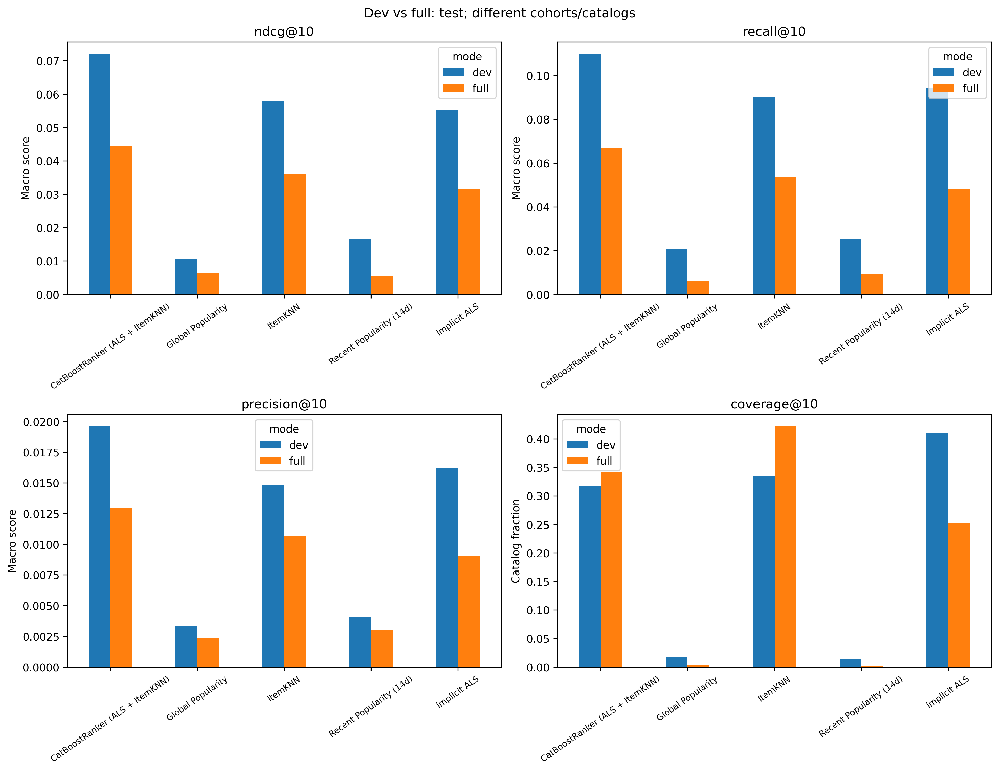

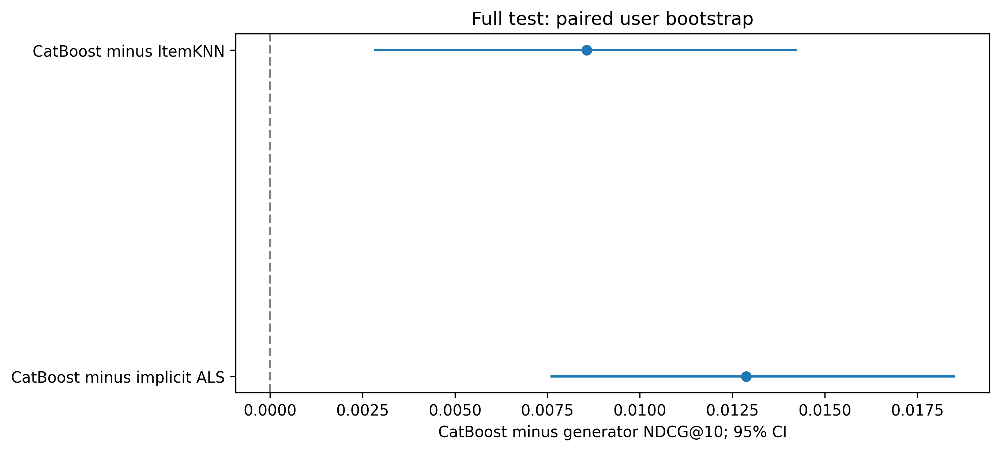

## Results (dev)

The primary metric is macro NDCG@10. This comparison uses **binary relevance**:
any view, cart addition, or transaction in the target interval is relevant.
The same users, fixed catalog, and relevance definition are used for every row.
The five models are global popularity, recent popularity, ItemKNN, library ALS
from `implicit`, and CatBoostRanker. All hyperparameter choices are made on
chronological validation data; test is used only for the final evaluation.
Binary relevance is also used to select ItemKNN/ALS parameters in notebook 02
and to evaluate the four shared models in notebook 03. Notebook 04 checks that
all shared NDCG, Recall, Precision, Coverage and evaluated-user counts match
02/03. Training interaction weights remain view=1, cart=3, transaction=5;
these weights do not define primary evaluation relevance.

| Model | Validation NDCG@10 | Test NDCG@10 | Test Recall@10 | Test Precision@10 | Test Coverage@10 |
|---|---:|---:|---:|---:|---:|
| Global Popularity | 0.0257 | 0.0107 | 0.0208 | 0.0034 | 0.0167 |
| Recent Popularity (14d) | 0.0326 | 0.0166 | 0.0253 | 0.0041 | 0.0133 |
| ItemKNN | 0.0695 | 0.0578 | 0.0900 | 0.0149 | 0.3347 |
| implicit ALS | 0.0816 | 0.0553 | 0.0944 | 0.0162 | 0.4107 |
| CatBoostRanker (ALS + ItemKNN) | **0.0914** | **0.0720** | **0.1098** | **0.0196** | 0.3167 |

Validation metrics average over 242 users; test metrics average over 148 users.
The benchmark uses a train-selected cohort of 20,000 users and a fixed
1,500-item catalog; only users with at least one new target item in that catalog
contribute to the ranking averages. In this run the selected CatBoostRanker
improves test NDCG and recall over the individual generators, but its catalog
coverage is lower than implicit ALS and ItemKNN. The test candidate recall is
**0.2753** for the deduplicated union of up to 100 candidates per source (up to
200 unique items), so many relevant products still do not reach the ranker.

The ItemKNN search selected `neighbors=50, shrinkage=10` (validation NDCG@10
**0.0695** under the binary protocol). The implicit ALS search selected
`factors=64, regularization=0.05, alpha=10, iterations=8` (validation NDCG@10
**0.0816**, binary). The three-configuration CatBoost search selected
`depth=6, learning_rate=0.03`, with best iteration 62 and validation NDCG@10
**0.0914** under binary relevance.

The validation-only feature ablation gives NDCG@10 **0.0914** with all 18
features, **0.0846** without the two score features, **0.0376** after removing
**all seven generator features** (scores, ranks, presence flags, candidate
source), and **0.0773** without user/item aggregates. Complete generator-feature
removal reduces NDCG by 0.05384 (58.9%); its paired 95% interval, variant minus
full model, is [−0.07909, −0.03069]. Removing only scores has an interval
[−0.01691, +0.00233], which includes zero. The full removal experiment retains
the same ALS/ItemKNN-generated candidates and all 11 user/item aggregates: it
measures added reranking information, not the value of candidate generation
itself. Each variant selects its own iteration on validation; the full feature
set is fixed for test independently of these diagnostic ablations.

Paired user bootstrap uses 5,000 resamples, seed 42, and percentile 95%
confidence intervals. CatBoost minus ItemKNN on test is **+0.01424** (+24.6%),
with CI **[−0.00956, +0.03727]**; CatBoost minus ALS is **+0.01675**,
CI **[−0.00374, +0.03822]**. Both include zero: this cohort does **not** establish
an improvement over the collaborative generators despite the higher means.
ALS minus ItemKNN on validation is +0.01209, CI [−0.00699, +0.03164].
These intervals are conditional on fixed models and this temporal cohort; they
do not account for shared-item dependence, training-seed variability, or
multiple comparisons. Validation intervals and ablations are further affected
by selection on the same validation period. They are diagnostic, not independent
confirmation. Test is never used to revise parameters or feature selection.

Test NDCG@10 by pre-test user activity also differs: CatBoost scores 0.0365,
0.0584, and 0.1266 in the low-, medium-, and high-activity groups respectively
(51, 51, and 46 evaluated users). It is slightly below ItemKNN for the
low-activity group (0.0404), but substantially higher for high-activity users
(ItemKNN 0.0766). The aggregate improvement therefore does not imply the same
benefit for users with little history.

Candidate recall has an explicit row schema: `generator`, `metric`, `cutoff`,
`recall`, `users`, `split`. Individual sources report **Recall@100**; the union
reports **Recall@200**. The union is restricted to each source's top 100 and
contains at most 200 distinct unseen items. Its improvement also includes a
larger candidate budget; it is not an equal-budget comparison. Users with
eligible targets but no candidates contribute zero.

`CandidateRankerRecommender` binds to a single `snapshot_id`. With multiple
snapshots callers must specify one explicitly; only that snapshot is scored.
The same user/item appearing in another period cannot enter its recommendations.

Machine-readable results:
[validation metrics](outputs/metrics/ltr_validation_metrics.csv),
[test metrics](outputs/metrics/ltr_test_metrics.csv),
[ItemKNN search](outputs/metrics/itemknn_tuning_validation.csv),
[ALS search](outputs/metrics/implicit_als_tuning_validation.csv),
[selected parameters](outputs/metrics/selected_model_params.json),
[CatBoost search](outputs/metrics/ltr_catboost_tuning_validation.csv),
[feature ablation](outputs/metrics/ltr_ablation_validation.csv),
[activity groups](outputs/metrics/ltr_activity_groups.csv),
[candidate recall](outputs/metrics/ltr_candidate_recall.csv),
[feature importance](outputs/metrics/ltr_feature_importance.csv),
[test paired confidence intervals](outputs/metrics/ltr_test_paired_intervals.csv),
[ablation intervals](outputs/metrics/ltr_ablation_paired_intervals.csv),
[test per-user scores](outputs/metrics/ltr_test_per_user.csv).

## Selected visualizations

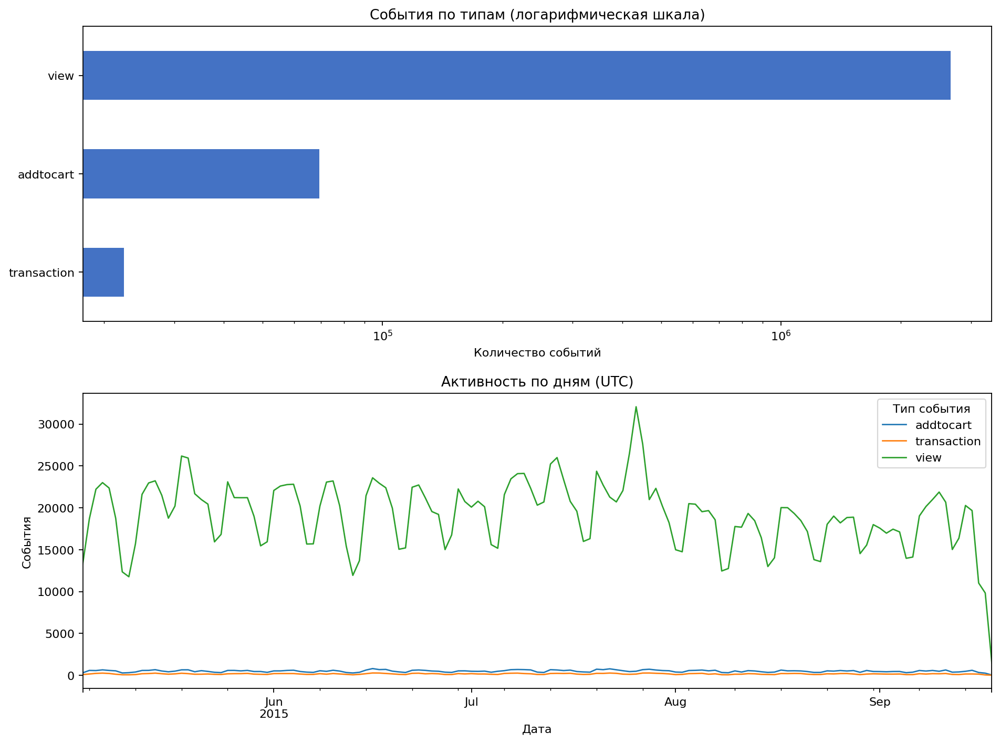

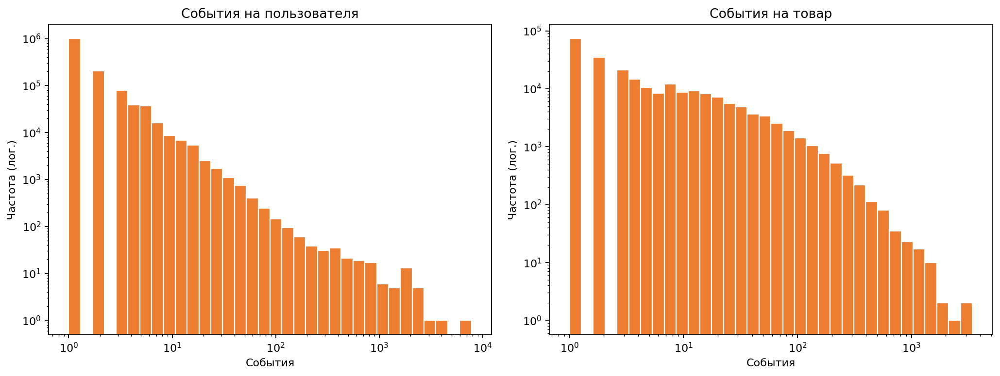

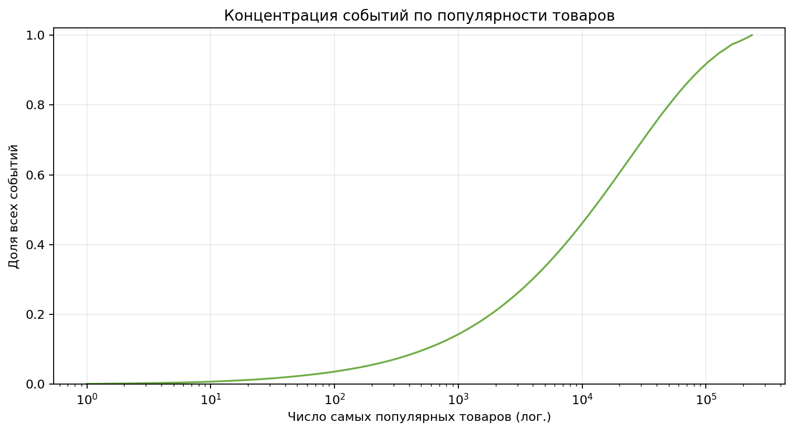

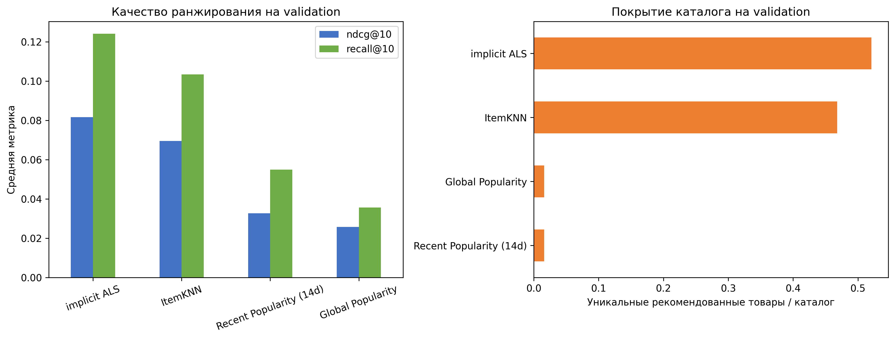

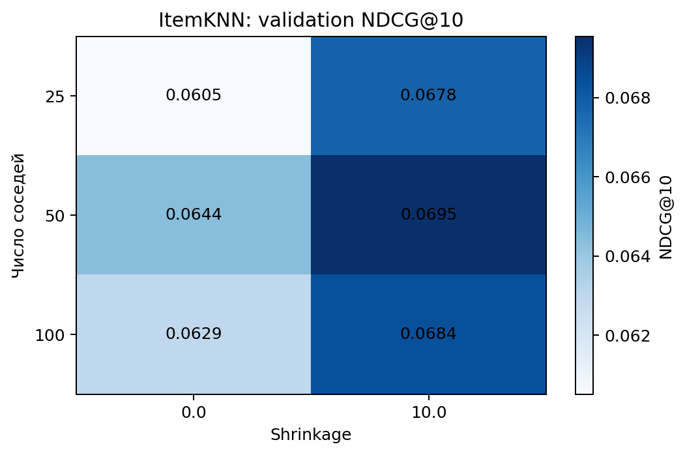

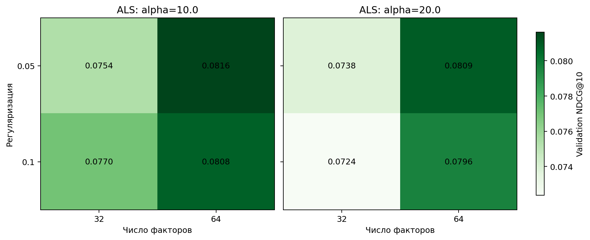

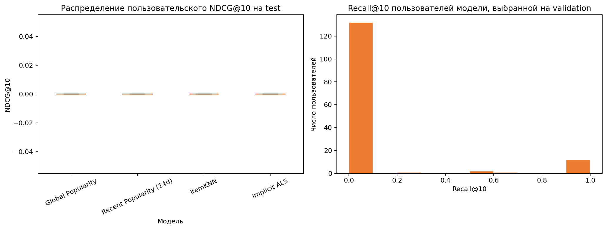

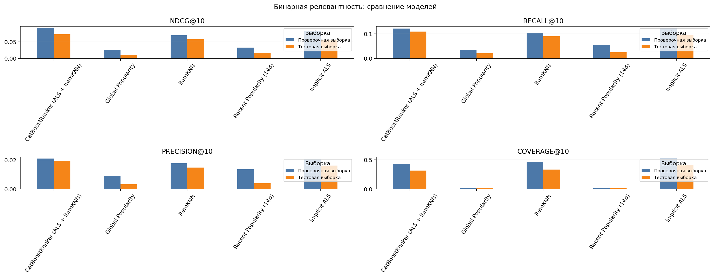

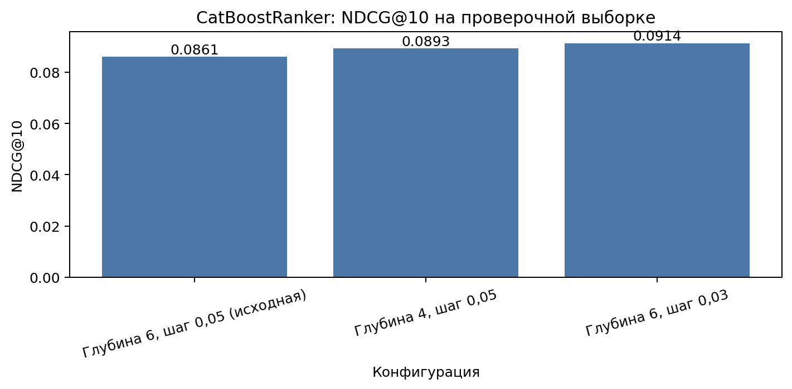

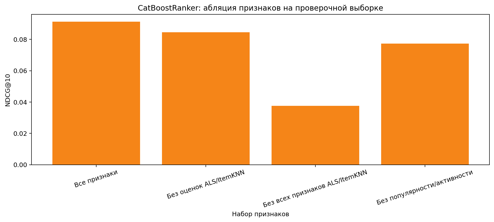

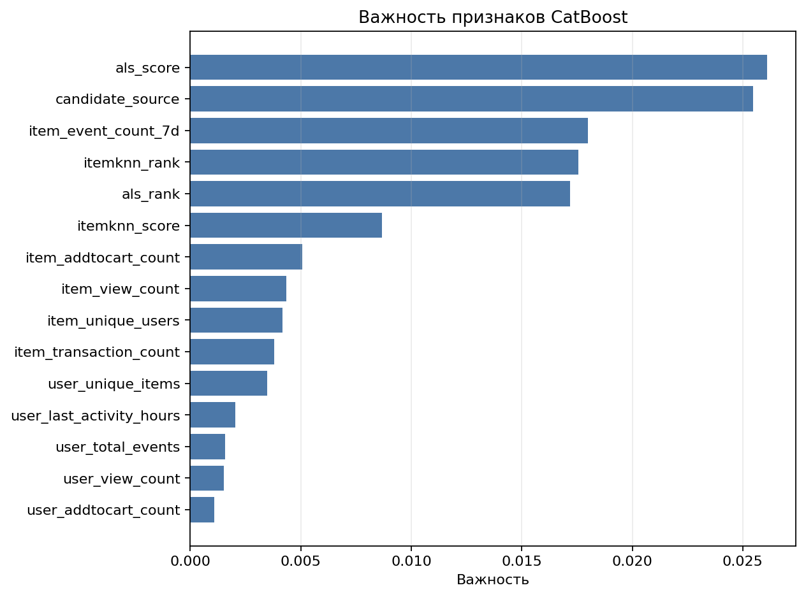

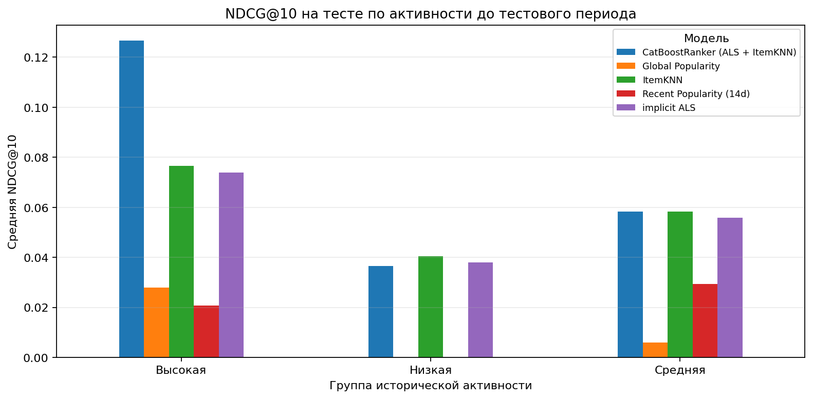

Original EDA plots from the reusable script are retained:
[event types](outputs/figures/event_types.png),
[daily activity](outputs/figures/daily_activity.png),
[top items](outputs/figures/top_items.png), and
[user activity](outputs/figures/user_activity.png).

## Dataset

This project uses the [Retailrocket E-commerce Dataset on Kaggle](https://www.kaggle.com/datasets/retailrocket/ecommerce-dataset).
The dataset is downloaded separately; **the entire `data/` directory is ignored
by Git**, including raw files, generated splits and `.gitkeep` files.

1. Open the Kaggle link and download the dataset archive (sign in if required).
2. Extract it locally. Create `data/raw/` in the project root and place
   **`events.csv` directly at `data/raw/events.csv`**, without an extra nested
   archive directory. Keep the original column names.
3. Other archive files can be kept in `data/raw/`; the current recommendation
   pipeline needs only `events.csv`. Item properties and the category tree are
   optional and are not used by the current models.
4. Generate `data/processed/` with the command below. Do not download or manually
   construct the processed splits: they are derived chronologically from events.

Expected local layout:

```text
data/                              # entirely excluded from Git
├── raw/
│   ├── events.csv                 # required: timestamp, visitorid, event, itemid
│   ├── category_tree.csv          # optional; unused by the current pipeline
│   ├── item_properties_part1.csv  # optional; unused by the current pipeline
│   └── item_properties_part2.csv  # optional; unused by the current pipeline
└── processed/                     # created automatically
    ├── train.csv
    ├── validation.csv
    ├── test.csv
    └── split_manifest.json
```

`events.csv` timestamps are Unix milliseconds. The loader converts them to UTC
and validates required columns. The EDA preparation command creates directories,
EDA figures and a reproducible 70/15/15 split by distinct timestamps; tied
timestamps stay together. It does not fit recommendation models. On an existing
checkout, running it regenerates processed splits and EDA outputs from the raw
file, so keep the same source dataset when reproducing saved experiments.

## Installation and data preparation

Run commands from the project root, using Python 3.9 or newer:

```bash
python -m venv .venv
source .venv/bin/activate
python -m pip install -r requirements.txt
mkdir -p data/raw
# Download and extract events.csv into data/raw/ as described above.
python -m scripts.run_eda
# Check data loading/splitting without fitting recommendation models:
python -m pytest -q tests/test_temporal_split.py
# Optional train-only benchmark preflight; does not fit models:
python -m scripts.run_experiments --mode dev --estimate-only
```

After preparation, notebook 01 studies the raw dataset and split boundaries;
02–03 tune/evaluate the base models and 04 handles learning to rank. To actually
run the model experiments, use the separate commands in the benchmark section
below; `python -m scripts.run_eda` alone never trains those models.

Before publishing, `git ls-files -- data/` should return no tracked files and
`git check-ignore data/raw/events.csv data/processed/train.csv` should identify
both paths as ignored. If a Git repository already tracks data, use
`git rm -r --cached data/`: it removes index entries while retaining local files.
Do not force-add ignored dataset files or their archives.

## Benchmark modes and reproduction checks

| Mode | User cap | Item cap | Output location |
|---|---:|---:|---|
| `dev` (default) | 20,000 | 1,500 | `outputs/`; executed notebooks in `outputs/dev/notebooks/` |
| `full` | 100,000 | 10,000 | `outputs/full/`, including separate executed notebooks |

Both modes retain identical global temporal boundaries and the minimum of five
train events. Sampling, catalog selection, and eligibility use train only;
refitting before test uses train + validation. The original rank-training
snapshot still uses all users with five events in its own early history
(45,908 here), with its own history-selected catalog. Mode selection does not
change this chronology. `full` means an expanded bounded benchmark, not all
Retailrocket items or a cold-start evaluation.

```bash
# Train-only preflight: no validation/test access, no model fitting.
python -m scripts.run_experiments --mode full --estimate-only
# Execute the unchanged search spaces in notebooks 02, 03, 04.
python -m scripts.run_experiments --mode dev
# Repeat the same experiment and compare 15 result tables + selected parameters.
python -m scripts.run_experiments --mode dev --verify-reproducibility
python -m pytest -q
# Expanded experiment, after reviewing the preflight resource allowances:
python -m scripts.run_experiments --mode full
```

The guarded CLI is preferred for full. Interactive execution with
`BENCHMARK_MODE=full` runs 02→03→04 without the CLI resource guard. The notebook code defaults to `dev`. Searches remain directly
in notebooks; the runner only provides the matching Python kernel, mode,
preflight, execution and reproducibility comparison. Notebook 01 and the raw
chronological split do not depend on benchmark mode.

The preflight on the supplied train data finds **57,811 eligible full users**,
10,000 items and 189,770 nonzero user-item pairs versus dev's 24,543. ItemKNN's
sum-of-squared-user-degrees work proxy grows **22.5×** (inner rank-training
snapshot: **7.7×**); the conservative all-cohort scoring proxy grows **19.3×**.
The rank-training candidate bound grows from 184,400 to 397,000 rows. The legacy dense
worst-case ItemKNN allowance (CSR/LIL/copies, 80 bytes per item pair) was
**7.45 GiB** in full versus 172 MiB in dev, plus roughly 388 MiB for candidate
feature rows and additional model/data copies. These are conservative planning
allowances, not measured peak RSS or elapsed-time predictions; sparsity may
reduce actual memory substantially. Model-selection grids are unchanged.

**Full execution is complete after the approved memory optimization.** ItemKNN now
computes 128 rows of co-occurrence at a time, with direct top-k CSR storage,
keeping the original scoring and tie handling. All six dev configurations
matched the legacy similarities, recommendations and metrics exactly; see the
[equivalence check](outputs/full/logs/itemknn_dev_equivalence.json). The updated
workspace allowance is approximately **60 MiB** for full ItemKNN rather than the
legacy dense planning allowance of 7.45 GiB. These are workspace estimates,
not total experiment RSS measurements. Snapshot objects are released between
stages; models, grids, eligibility and the full catalog were not reduced.

The guarded full runner saves completed notebook checkpoints and skips them on
resume. It reuses completed search/ablation tables and verifies reconstruction
of the selected ranker before final evaluation. The first attempt stopped on
swap growth, then continued under an explicit user override; both attempts and
remaining emergency limits are recorded in the manifest. It reads canonical
notebook code unchanged; source fingerprints protect completed checkpoints. The default command
retains the conservative guard. `--allow-swap-growth` is an explicit override,
not the default:

```bash
python -m scripts.run_full
# Only after explicitly accepting additional system-wide swap growth:
python -m scripts.run_full --allow-swap-growth
python -m scripts.summarize_full
```

The original stop decision remains in the logs as history; the current status
and completed artifacts are described in [the full report](outputs/full/REPORT.md).
Dev notebook runtimes and exact package versions are recorded in the
[execution manifest](outputs/metrics/execution_manifest.json). Data, cohort,
catalog and profile fingerprints are recorded in the
[benchmark manifest](outputs/metrics/benchmark_manifest.json). Notebooks 03/04
reject parameters from a different profile, train dataset or relevance protocol.
A repeated dev run is checked in
[reproducibility_check.json](outputs/metrics/reproducibility_check.json); timing
is excluded and metric comparisons use rtol=1e−7 / atol=1e−9. Repeating the same
final evaluation checks reproducibility, not independent generalization.

Original research artifacts and executed notebooks are retained in
[`outputs/archive/pre_binary_unification/`](outputs/archive/pre_binary_unification/PROTOCOL.md).
Those historical 02/03 results used graded NDCG and the old candidate union
label; they are provenance only and must not be merged into current comparisons.

## Modeling and evaluation decisions

- Events are ordered in UTC and split 70/15/15 by distinct timestamps. Tied
  timestamps stay together. The saved boundaries are checked to be strictly
  chronological; the test starts at 2015-08-25 22:39:44 UTC.
- Event strengths for collaborative-model training are `view=1`,
  `addtocart=3`, and `transaction=5`; repeated user-item events are summed.
  All primary evaluation and validation selection use binary targets for
  every model; training weights are separate from evaluation relevance.
- Cohort eligibility (at least five train events), the deterministic sample
  (seed 42), and top-1,500 item catalog are determined from train only.
- ItemKNN and implicit ALS hyperparameters are selected by NDCG@10 on the
  chronological validation split. CatBoostRanker uses a small validation-only
  search and early stopping. The test period is loaded only after these choices
  are fixed; final base models are refit on train + validation.
- Every recommendation excludes items already in the user's available
  pre-target history. Macro NDCG@10 is primary; Recall@10, Precision@10,
  catalog Coverage@10, and cold-start diagnostics add complementary views.
- ItemKNN uses cosine item co-occurrence with shrinkage. ALS is used only via
  the library `implicit.als.AlternatingLeastSquares`. CatBoostRanker only
  reorders the union of ItemKNN and implicit ALS candidates.
- Cold-start users have no interaction history for personalization, and items
  outside the train-selected catalog cannot enter this candidate set. A
  production system would need popularity fallbacks and/or item metadata.

## Two-stage ranking workflow

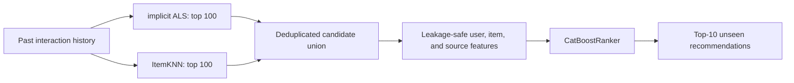

Ranker examples use an additional chronological split inside the original
train period. User/item aggregates and candidate scores are computed from the
history before each snapshot; future events are attached afterward as labels.
The test model's candidate generators use train plus validation, never test.
Model parameters, CatBoost version, time boundaries, and best validation
iteration are saved in
[`outputs/models/catboost_ranker_config.json`](outputs/models/catboost_ranker_config.json);
the fitted model is
[`outputs/models/catboost_ranker.cbm`](outputs/models/catboost_ranker.cbm).

## Repository layout

```text
data/raw/          # local source dataset (not committed)
data/processed/    # generated temporal splits (not committed)
notebooks/         # canonical source + research narrative for dev and full
outputs/dev/notebooks/ # executed dev artifacts; never the source for future runs
outputs/figures/   # saved EDA/model/error-analysis figures
outputs/metrics/   # EDA, validation/test, tuning, ablation, and LTR tables
outputs/models/    # fitted dev CatBoost ranker and experiment configuration
outputs/full/      # completed expanded benchmark, separate figures/models/logs
outputs/archive/   # preserved historical research, with its protocol caveats
scripts/           # reproducible commands
src/               # reusable data, models, tuning, and evaluation
tests/             # temporal, recommendation, and ranking correctness tests
```
