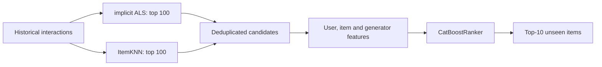

# Retailrocket E-commerce Recommender

An end-to-end recommendation system built on implicit e-commerce interactions. The project compares popularity baselines, item-based collaborative filtering, and matrix factorization, then combines candidate generation with **CatBoost learning-to-rank**.

**Highlights:** chronological evaluation to limit data leakage · validation-based model selection · two-stage ranking · feature ablation · paired bootstrap confidence intervals · reproducible dev and expanded benchmarks.

## Results

The table reports performance on the **expanded (`full`) chronological test benchmark**. The primary metric is macro **NDCG@10**, with binary relevance for views, cart additions, and transactions.

| Model | NDCG@10 ↑ | Recall@10 ↑ | Precision@10 ↑ | Coverage@10 ↑ |
|---|---:|---:|---:|---:|
| **CatBoostRanker (ALS + ItemKNN)** | **0.04455** | **0.06686** | **0.01295** | 0.34090 |
| ItemKNN | 0.03599 | 0.05348 | 0.01068 | **0.42160** |
| implicit ALS | 0.03168 | 0.04821 | 0.00907 | 0.25210 |
| Global Popularity | 0.00639 | 0.00597 | 0.00236 | 0.00340 |
| Recent Popularity (14d) | 0.00554 | 0.00929 | 0.00302 | 0.00240 |

**Key findings**

- The two-stage CatBoostRanker achieved the highest test NDCG@10 and Recall@10, while ItemKNN retained the highest catalog coverage.
- Compared with ItemKNN, the ranker's test NDCG@10 increased by **0.00856** (95% paired bootstrap CI: **[0.00282, 0.01424]**). Compared with ALS, the increase was **0.01287** (CI: **[0.00759, 0.01852]**). These intervals are conditional on the evaluated users and fixed fitted models; they do not establish generalization across time periods or training seeds.
- Validation ablation showed that removing all seven candidate-generator features reduced NDCG@10 from **0.06581** to **0.02273** on the same candidate sets. This supports the importance of generator-derived information for reranking, not a causal estimate of feature effects.

The expanded benchmark evaluated **1,058 test users** with eligible new in-catalog interactions, using a train-selected catalog of **10,000 items**. The smaller dev benchmark uses a different cohort and catalog, so its scores should not be compared as if they were controlled improvements.

More detail: [full experiment report](outputs/full/REPORT.md) · [dev/full comparison](outputs/full/metrics/dev_full_comparison.csv) · [paired test contrasts](outputs/full/metrics/catboost_test_contrasts.csv).

## Recommendation pipeline



1. **Candidate generation:** ItemKNN and implicit ALS each retrieve up to 100 items per user; previously seen items are excluded.
2. **Feature engineering:** candidate scores, ranks, source indicators, and user/item activity statistics are calculated from available historical data.
3. **Reranking:** CatBoostRanker orders the combined candidates to produce top-10 recommendations.

The model can rerank only generated candidates: items missed by both generators cannot be recovered downstream. Cold-start users and items outside the train-selected catalog remain limitations.

## Data and evaluation

The project uses the [Retailrocket E-commerce Dataset](https://www.kaggle.com/datasets/retailrocket/ecommerce-dataset), with `view`, `addtocart`, and `transaction` events.

- **Temporal split:** 70% train / 15% validation / 15% test by distinct event timestamps; tied timestamps stay together.
- **Training signals:** interaction weights of 1 (view), 3 (cart), and 5 (transaction). Evaluation relevance is **binary**, independently of these training weights.
- **Model selection:** ItemKNN, ALS, and CatBoost parameters are selected using chronological validation; the final test period is reserved for evaluation.
- **Metrics:** macro NDCG@10, Recall@10, Precision@10, Coverage@10, plus candidate-recall and user-activity diagnostics.

## Project structure

| Path | Contents |
|---|---|
| [`notebooks/`](notebooks/) | Source notebooks: EDA, modeling, evaluation, and learning-to-rank |
| [`src/`](src/) | Reusable data processing, recommendation, and evaluation code |
| [`scripts/`](scripts/) | Data preparation and experiment runners |
| [`tests/`](tests/) | Tests for temporal splitting and recommendation logic |
| [`outputs/`](outputs/) | Dev metrics, figures, models, and executed notebooks |
| [`outputs/full/`](outputs/full/) | Expanded benchmark results, reports, and execution artifacts |

**Notebook walkthrough:** [01 · EDA](notebooks/01_eda.ipynb) · [02 · Baselines & collaborative filtering](notebooks/02_modeling.ipynb) · [03 · Evaluation](notebooks/03_evaluation.ipynb) · [04 · Learning to rank](notebooks/04_learning_to_rank.ipynb).

## Quick start

Requires **Python 3.9+**. Download the Retailrocket dataset from Kaggle and place `events.csv` at `data/raw/events.csv`. Raw and processed data are excluded from Git.

```bash
python -m venv .venv
source .venv/bin/activate
python -m pip install -r requirements.txt
mkdir -p data/raw
# Place the downloaded events.csv in data/raw/
python -m scripts.run_eda

# Run the smaller development benchmark (notebooks 02–04)
python -m scripts.run_experiments --mode dev

# Run tests
python -m pytest -q
```

For the expanded benchmark, first inspect resource estimates and then run:

```bash
python -m scripts.run_experiments --mode full --estimate-only
python -m scripts.run_experiments --mode full
```

The full runner includes resource safeguards and checkpoint/resume behavior. See the [full report](outputs/full/REPORT.md) and [executed full notebooks](outputs/full/notebooks/README.md) for details. Source notebooks are maintained separately from their executed copies.

## Limitations and next steps

- Evaluation is offline and restricted to eligible users and a train-selected item catalog; it does not measure online business impact.
- Candidate recall limits the reranker's ceiling; expanding retrieval and evaluating equal candidate budgets would be useful next steps.
- Cold-start support would require additional strategies, such as popularity fallbacks or item metadata.
- Bootstrap intervals reflect user resampling within this test cohort, not variability across time windows, random seeds, or multiple comparisons.
