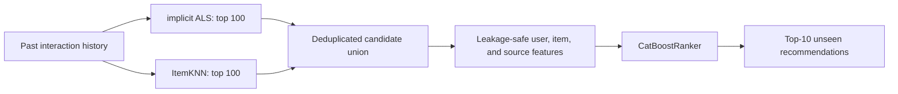

# Retailrocket E-commerce Recommender

An end-to-end implicit-feedback recommendation project on the Retailrocket
e-commerce dataset. The notebooks walk from exploratory analysis through
leakage-aware model selection to a final chronological test evaluation. Reusable
loading, splitting, recommendation, and metric code lives in `src/`.

## Project walkthrough

Open the executed notebooks on GitHub in order:

1. [01_eda.ipynb](notebooks/01_eda.ipynb) — event mix, time trends, user/item
   activity, matrix sparsity, and split checks.
2. [02_modeling.ipynb](notebooks/02_modeling.ipynb) — Global/Recent Popularity,
   ItemKNN and implicit ALS, including validation-only hyperparameter search.
3. [03_evaluation.ipynb](notebooks/03_evaluation.ipynb) — final test evaluation
   of the validation-selected baselines and recommenders, errors, cold start,
   and recommendation examples.
4. [04_learning_to_rank.ipynb](notebooks/04_learning_to_rank.ipynb) — a
   two-stage ItemKNN + implicit ALS candidate pipeline, CatBoostRanker search,
   feature ablations, and final five-model comparison.

Each notebook contains its executed outputs, including inline visualizations.
The same figures and machine-readable metrics are saved under `outputs/`.

## Results

The primary metric is macro NDCG@10. This comparison uses **binary relevance**:
any view, cart addition, or transaction in the target interval is relevant.
The same users, fixed catalog, and relevance definition are used for every row.
The five models are global popularity, recent popularity, ItemKNN, library ALS
from `implicit`, and CatBoostRanker. All hyperparameter choices are made on
chronological validation data; test is used only for the final evaluation.
The modeling/evaluation notebooks use graded event relevance (view=1,
add-to-cart=3, transaction=5); the table here uses binary relevance for all
five systems. Results across these two relevance protocols are not directly
comparable.

| Model | Validation NDCG@10 | Test NDCG@10 | Test Recall@10 | Test Precision@10 | Test Coverage@10 |
|---|---:|---:|---:|---:|---:|
| Global Popularity | 0.0257 | 0.0107 | 0.0208 | 0.0034 | 0.0167 |
| Recent Popularity (14d) | 0.0326 | 0.0166 | 0.0253 | 0.0041 | 0.0133 |
| ItemKNN | 0.0695 | 0.0578 | 0.0900 | 0.0149 | 0.3347 |
| implicit ALS | 0.0816 | 0.0553 | 0.0944 | 0.0162 | 0.4107 |
| CatBoostRanker (ALS + ItemKNN) | **0.0914** | **0.0720** | **0.1098** | **0.0196** | 0.3167 |

Validation metrics average over 242 users; test metrics average over 148 users.
The benchmark uses a train-selected cohort of 20,000 users and a fixed
1,500-item catalog; only users with at least one new target item in that catalog
contribute to the ranking averages. In this run the selected CatBoostRanker
improves test NDCG and recall over the individual generators, but its catalog
coverage is lower than implicit ALS and ItemKNN. The test candidate recall is
**0.2753** for the deduplicated union of up to 100 candidates per source (up to
200 unique items), so many relevant products still do not reach the ranker.

The ItemKNN search selected `neighbors=50, shrinkage=10` (validation NDCG@10
**0.0655** under the graded protocol). The implicit ALS search selected
`factors=64, regularization=0.05, alpha=10, iterations=8` (validation NDCG@10
**0.0765**, graded). The three-configuration CatBoost search selected
`depth=6, learning_rate=0.03`, with best iteration 62 and validation NDCG@10
**0.0914** under binary relevance.

The validation-only feature ablation gives NDCG@10 **0.0914** with all 18
features, **0.0846** without ALS/ItemKNN score features, and **0.0773** without
user/item popularity and activity aggregates. These results suggest both
feature groups help on this validation cohort; the ablation is diagnostic and
does not use test for feature selection.

Test NDCG@10 by pre-test user activity also differs: CatBoost scores 0.0365,
0.0584, and 0.1266 in the low-, medium-, and high-activity groups respectively
(51, 51, and 46 evaluated users). It is slightly below ItemKNN for the
low-activity group (0.0404), but substantially higher for high-activity users
(ItemKNN 0.0766). The aggregate improvement therefore does not imply the same
benefit for users with little history.

Machine-readable results:
[validation metrics](outputs/metrics/ltr_validation_metrics.csv),
[test metrics](outputs/metrics/ltr_test_metrics.csv),
[ItemKNN search](outputs/metrics/itemknn_tuning_validation.csv),
[ALS search](outputs/metrics/implicit_als_tuning_validation.csv),
[selected parameters](outputs/metrics/selected_model_params.json),
[CatBoost search](outputs/metrics/ltr_catboost_tuning_validation.csv),
[feature ablation](outputs/metrics/ltr_ablation_validation.csv),
[activity groups](outputs/metrics/ltr_activity_groups.csv),
[candidate recall](outputs/metrics/ltr_candidate_recall.csv),
[feature importance](outputs/metrics/ltr_feature_importance.csv).

## Selected visualizations


Original EDA plots from the reusable script are retained:
[event types](outputs/figures/event_types.png),
[daily activity](outputs/figures/daily_activity.png),
[top items](outputs/figures/top_items.png), and
[user activity](outputs/figures/user_activity.png).

## Dataset and reproduction

Download the Retailrocket dataset from
[Kaggle](https://www.kaggle.com/datasets/retailrocket/ecommerce-dataset) and
place `events.csv` at `data/raw/events.csv`. Raw data and generated split CSVs
are excluded from version control.

```bash
python -m pip install -r requirements.txt
python -m scripts.run_eda
jupyter lab
```

Run notebooks in order. `01_eda.ipynb` reads the raw events and checks the
generated split files. Notebooks 02–03 tune and evaluate the core baselines and
collaborative models; `04_learning_to_rank.ipynb` writes the binary-relevance
LTR metrics, figures, and model artifacts under `outputs/`. To regenerate the
EDA figures and chronological splits independently, run
`python -m scripts.run_eda`.

## Modeling and evaluation decisions

- Events are ordered in UTC and split 70/15/15 by distinct timestamps. Tied
  timestamps stay together. The saved boundaries are checked to be strictly
  chronological; the test starts at 2015-08-25 22:39:44 UTC.
- Event strengths for collaborative-model training are `view=1`,
  `addtocart=3`, and `transaction=5`; repeated user-item events are summed.
  The LTR experiment instead uses the explicitly documented binary target for
  all four evaluation models.
- Cohort eligibility (at least five train events), the deterministic sample
  (seed 42), and top-1,500 item catalog are determined from train only.
- ItemKNN and implicit ALS hyperparameters are selected by NDCG@10 on the
  chronological validation split. CatBoostRanker uses a small validation-only
  search and early stopping. The test period is loaded only after these choices
  are fixed; final base models are refit on train + validation.
- Every recommendation excludes items already in the user's available
  pre-target history. Macro NDCG@10 is primary; Recall@10, Precision@10,
  catalog Coverage@10, and cold-start diagnostics add complementary views.
- ItemKNN uses cosine item co-occurrence with shrinkage. ALS is used only via
  the library `implicit.als.AlternatingLeastSquares`. CatBoostRanker only
  reorders the union of ItemKNN and implicit ALS candidates.
- Cold-start users have no interaction history for personalization, and items
  outside the train-selected catalog cannot enter this candidate set. A
  production system would need popularity fallbacks and/or item metadata.

## Two-stage ranking workflow



Ranker examples use an additional chronological split inside the original
train period. User/item aggregates and candidate scores are computed from the
history before each snapshot; future events are attached afterward as labels.
The test model's candidate generators use train plus validation, never test.
Model parameters, CatBoost version, time boundaries, and best validation
iteration are saved in
[`outputs/models/catboost_ranker_config.json`](outputs/models/catboost_ranker_config.json);
the fitted model is
[`outputs/models/catboost_ranker.cbm`](outputs/models/catboost_ranker.cbm).

## Repository layout

```text
data/raw/          # local source dataset (not committed)
data/processed/    # generated temporal splits (not committed)
notebooks/         # executed EDA, modeling, evaluation, and LTR walkthrough
outputs/figures/   # saved EDA/model/error-analysis figures
outputs/metrics/   # EDA, validation/test, tuning, ablation, and LTR tables
outputs/models/    # fitted CatBoost ranker and experiment configuration
scripts/           # reproducible commands
src/               # reusable data, models, tuning, and evaluation
tests/             # temporal, recommendation, and ranking correctness tests
```
